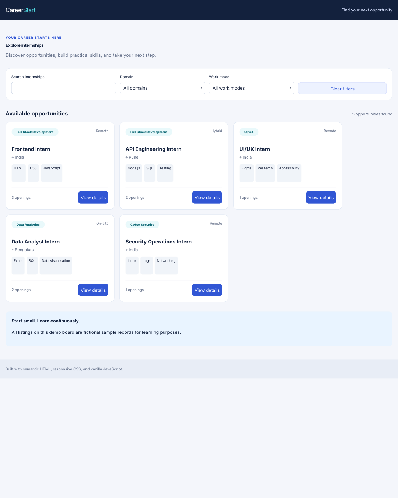
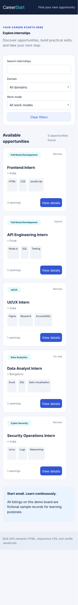

# Responsive Internship Board

An accessible, responsive internship listing interface built with semantic HTML, CSS, and vanilla JavaScript — no frontend framework.

## Features

- Responsive layout for mobile, tablet, and desktop
- Reusable cards rendered from the supplied JSON data file
- Keyword search across title, domain, mode, location, and skills
- Domain and work-mode filters, plus clear filters
- Loading, empty-results, and data-load error/retry states
- Keyboard-friendly details dialog, visible focus, skip link, labeled fields, and live status messages
- Demo application form with browser validation; it does not send or store submissions
- Fictional sample internships only

## Run locally

Use a local web server because browsers commonly block JSON `fetch()` requests from a `file://` URL.

With Python installed, run this command from the project folder:

```bash
python -m http.server 8000
```

Open `http://localhost:8000`. Alternatively, use the VS Code Live Server extension.

## Project structure

```text
responsive-internship-board/
├── index.html
├── style.css
├── script.js
├── data/
│   └── internship-records-sample.json
├── screenshots/
│   ├── desktop.png
│   └── mobile.png
└── README.md
```

## Test checklist

- Search `JavaScript`, `analyst`, and `remote`.
- Combine domain and work-mode filters.
- Search `zz-not-found` and confirm the empty state appears.
- Click **Clear filters** and confirm all five listings return.
- Temporarily rename the JSON file to test the error message and retry button, then restore its name.
- Navigate with Tab and Shift+Tab; activate controls with Enter or Space.
- Open a card and press Escape to close its details dialog.
- Test form validation with invalid and valid name/email values.
- Check 360px mobile, 768px tablet, and desktop widths for horizontal overflow.

## Screenshots

### Desktop preview



### Mobile preview



## Deploy with GitHub Pages

1. Create a **public** GitHub repository named `responsive-internship-board`.
2. Upload every file and folder in this project, including `data/` and `screenshots/`.
3. Open **Settings → Pages**.
4. Select **Deploy from a branch**, choose `main` and `/(root)`, then save.
5. Wait for deployment, open the generated URL, and test the search and filters.
6. Record your actual repository and live preview URLs in your task submission.

**Live preview:** Add your published GitHub Pages URL here after deployment.

All listings are fictional sample records for learning purposes. The application form is only a front-end demonstration.
